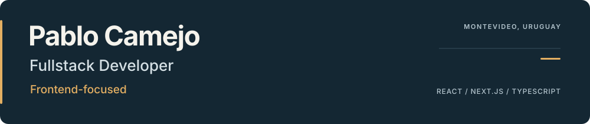

Montevideo, Uruguay · [LinkedIn](https://www.linkedin.com/in/pablo-camejo-rodriguez/)

### 🧭 Focus

I build web applications with React, Next.js and TypeScript, with a strong focus on frontend architecture, product interfaces and reusable foundations. I also contribute to Node.js/NestJS integrations and Redis caching.

### 🧰 Stack

**Frontend** · React, Next.js, TypeScript  
**Integration** · Node.js, NestJS, Redis  
**Testing & delivery** · Playwright, Jest, GitHub Actions, pnpm

### 🧪 Featured lab

> **[Dependency Boundaries](https://github.com/Pabloc43/lab-dependency-boundaries)**
>
> A working order-flow POC that checks architectural boundaries and circular dependencies through real CI, with interactive diagrams and code-generated evidence.
>
> [Source](https://github.com/Pabloc43/lab-dependency-boundaries) · [Live demo](https://pabloc43.github.io/lab-dependency-boundaries/) · [CI](https://github.com/Pabloc43/lab-dependency-boundaries/actions)

### 💼 Experience

**Pormel** — Frontend architecture, multi-theme Design Systems and shared libraries; migration from Module Federation to Next.js Multi-Zones.

**Previously, Cencosud/Cencommerce** — E-commerce development for Paris.cl: interfaces, SEO, performance and API integrations.
